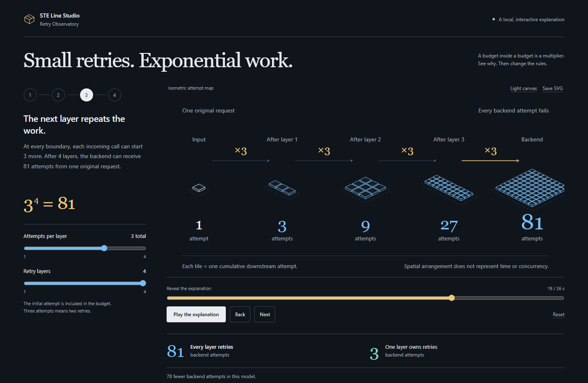
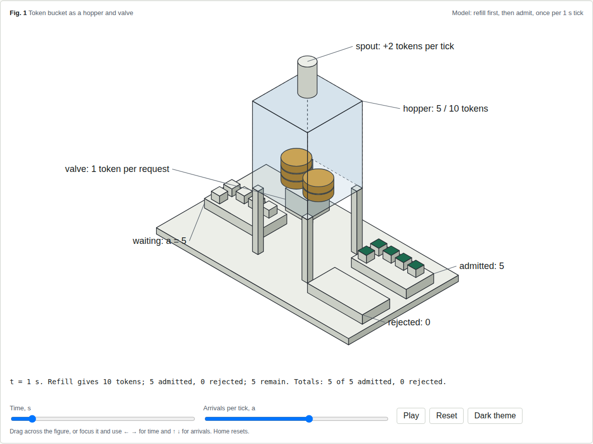
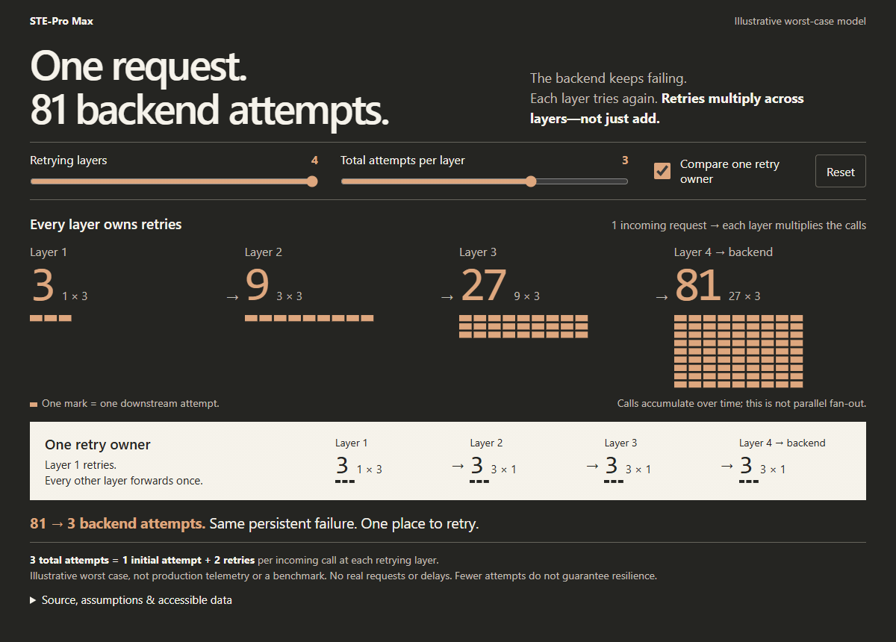
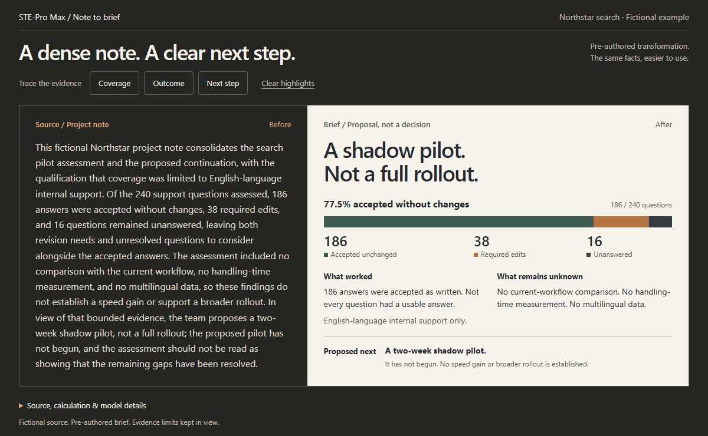
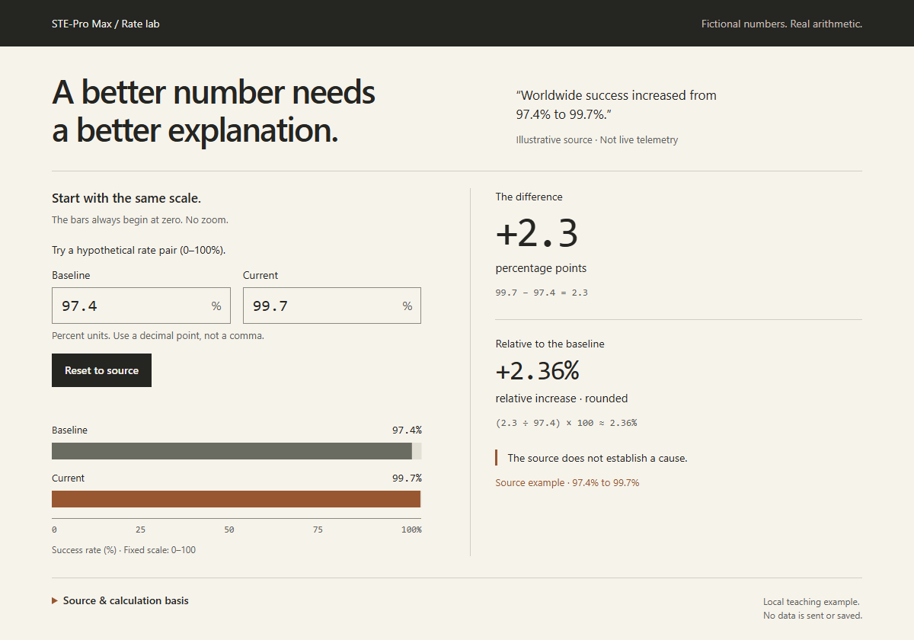

<p align="center">
  
</p>

# STE-Pro Max

**Clear writing. Evidence-linked explanations.**

STE-inspired writing and Karpathy-inspired explanations: **briefs, diagrams,
and interactive documents**.

**Copilot CLI + OpenCode.** Automatic checks. Other hosts: legacy skills only.

[STE](#ste-the-foundation) · [Karpathy](#karpathys-guidelines-put-to-work) · [Demos](#show-dont-tell) · [SkillC](docs/SKILLC_GATE.md) · [Install](#install-the-plugin) · [Docs](docs/README.md)

## STE: the foundation

**STE means Simplified Technical English**, a controlled writing language.
Here, clearer language must preserve facts and uncertainty.

> **Before:** “Prior to initiating deployment, verification of the configuration is required.”
>
> **STE:** “Check the configuration before you deploy.”

STE-inspired, not ASD-STE100 certification. [The approach](docs/APPROACH.md).

## Karpathy's guidelines, put to work

Our takeaways from [his post](https://x.com/karpathy/status/2105819303471976479):

- **Write clearly:** relaxed STE.
- **Explain mechanisms:** diagrams and images.
- **Make it explorable:** interactive HTML, controls, and animation.
- **Narrate** only with an available media tool.
- **Build to explain:** small, purpose-built software.

Choose the **smallest useful medium**. Keep the evidence inspectable.

## Show, don't tell

### Line Studio: see the mechanism

> “Make 81 → 3 explorable.”

[](examples/showcase/retry-observatory.html)

Adjust budgets, scrub, export SVG. [Guide](docs/LINE_STUDIO.md).

[](examples/showcase/token-bucket-mechanism.html)

*New in v0.5.0.*

### One request. 81 backend attempts.

> “Show me why retries multiply. Let me change the rules.”

[](examples/showcase/retry-storm.html)

[Explore](examples/showcase/retry-storm.html) · [Still](docs/assets/retry-storm.png).

### A dense note becomes an evidence-linked brief

> “Turn this pilot write-up into a one-screen briefing. Keep the evidence.”

[](examples/showcase/brief-transformation.html)

[Trace the claims to source](examples/showcase/brief-transformation.html).

### Compare rates without losing context

> “Explain 97.4% → 99.7%. Let me change the baseline.”

[](examples/showcase/rate-lab.html)

[Explore percentage points versus relative change](examples/showcase/rate-lab.html).

**Working HTML, not UI mockups.** Fictional data and illustrative models.
[Get examples](docs/EXAMPLES.md#get-the-files). No build or server.

## Automatic SkillC checks in v0.6.1

**SkillC makes STE’s tools check their work before reporting success.**
`render`, `narrate`, and `export` check inputs, declared evidence, and actual outputs.

Missing declared evidence blocks a bundle. Changed evidence blocks export.
Empty or invalid audio fails preparation.

**This is workflow checking, not an English tutor or fact-checker.**
No manual approval step. Native STE tools need a configured runtime.
**STE does not restrict your other tools.** No off command; host permissions still apply.

[Why it matters and how it works](docs/SKILLC_GATE.md) · [Credits](docs/SKILLC_CREDITS.md) · [Tested scope](docs/VALIDATION.md).

## Install the plugin

Install **v0.6.1**. Native tools need a [configured runtime](docs/SKILLC_GATE.md#runtime-configuration).

<details open>
<summary><strong>GitHub Copilot CLI</strong></summary>

```sh
copilot plugin marketplace add shyamsridhar123/STE-Pro-Max#v0.6.1
copilot plugin install ste-pro-max@ste-pro-max-plugins
```

</details>

<details>
<summary><strong>Claude Code — legacy v0.5.0 skills</strong></summary>

```sh
claude plugin marketplace add shyamsridhar123/STE-Pro-Max#v0.5.0
claude plugin install ste-pro-max@ste-pro-max-plugins
```

</details>

<details>
<summary><strong>Codex CLI — legacy v0.5.0 skills</strong></summary>

```sh
codex plugin marketplace add shyamsridhar123/STE-Pro-Max --ref v0.5.0
codex plugin add ste-pro-max@ste-pro-max-plugins
```

</details>

> Use STE-Pro Max on this material. Make it clear, visual, and interactive where it helps.

[Host versions, updates & uninstall](docs/PLUGINS.md) · [More prompts](docs/EXAMPLES.md#steal-these-prompts)

[Documentation](docs/README.md) · [All examples](docs/EXAMPLES.md) · [Advanced engine](docs/AUTHORING.md) · [Apache-2.0](LICENSE)
